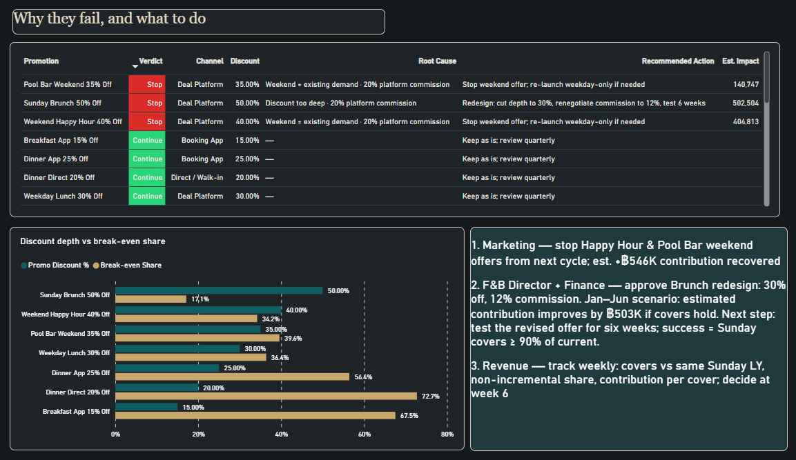

# Which promotions should we stop before high season?
### A Power BI decision project — hotel F&B promotions, judged on contribution, not revenue


**[⬇ Download the Power BI file (.pbix)](pbix/FnB_Promo_Decision.pbix)** · [SQL views](sql/01_views.sql) · [Synthetic data](data/)

> **Four of the seven offers are worth keeping.** For the other three, I estimate the restaurants would have earned about ฿992K more without the discounts, after food costs and commissions. Sunday Brunch is the one I'd redesign rather than drop: it served 28% more guests than on the same Sundays last year, but the 50% discount left only ฿155 per guest after those costs.

**Everything here is synthetic.** Hotel data is generated; stakeholder requests are simulated from real patterns in my current job. No employer data.

---

## 1. The request, and the real need (simulated)

A Director of F&B asks: *"Can you give me a report of how our promotions performed this year?"*

Three questions before opening Power BI:

| Question | Answer |
|---|---|
| What decision will this report change? | Which promotions to keep for Q4, which to drop |
| What does "performed" mean — revenue, covers or profit? | "Revenue… but Finance says some promos lose money" |
| Who else acts on it? | Marketing (runs promos), Finance (approves discounts), outlet managers, the GM |

I designed the report around one decision: **which offers should the F&B team renew, change or stop?** — judged on contribution after discount, food cost and channel commission, with each outlet manager seeing only their own outlets.

## 2. What the report says (Jan–Jun 2026, synthetic)

- Revenue is on budget (฿222.3M, +0.1%).
- **4 promotions continue; 3 should stop on their current terms.** Estimated contribution shortfall from those 3: **−฿992K** (sum of the three, not the net of all seven).
- The baseline suggests the two weekend deal-platform offers (Happy Hour 40%, Pool Bar 35%) reach mostly guests who would have come anyway — an estimated 62–68% of promo users, against a break-even share of 34–40%.
- **Sunday Brunch 50% Off is a redesign candidate, not a drop:** covers were 28% above the same Sundays last year, but at ฿646 off per head only ฿155 of contribution remains, so it tolerates at most 17% non-incremental guests and the baseline estimate is 45%.
- **Proposed redesign:** Brunch at 30% off with a 12% platform commission. Recomputed on the same Jan–Jun covers, prices and costs, and assuming covers hold, the offer moves from an estimated −฿446K to about +฿57K — an improvement of ≈ ฿503K versus the current offer over that period. **Proposed test:** run it for 6 weeks; whether covers hold is what the test must confirm.

## 3. How the team uses the report

| Page | Who | Answers |
|---|---|---|
| **Executive** | GM / Director | Are promotions helping or hurting contribution? Performance → Decision → Next step |
| **Promotion Decisions** | Director / Marketing / Finance | Which to continue, review, stop — why — and does the answer survive a different assumption? (what-if slider) |
| **Diagnosis & Action Plan** | F&B leadership | Root cause per promotion (discount depth / weekend demand / channel commission), recommended action, estimated impact, owners and success metric |




## 4. How I decided which offers to keep

I compared what the restaurant earned on promotion days with what I estimate it would have earned without the offer. SQL calculates the campaign metrics; DAX uses them to assign the verdict shown in Power BI.

**Baseline covers** = covers on the **same weekday last year** (364 days back, Sunday vs Sunday), same outlet and meal period, on a day with no promotion. We estimate contribution without the offer using last year's matched covers and **this year's full-price contribution per cover on the promotion days** — last year sets the volume, this year sets the economics.

| Term | Formula | Plain English |
|---|---|---|
| Uplift | covers on promo days ÷ baseline − 1 | how many more guests came than the same days last year |
| Est. non-incremental share *s* | (promo covers − incremental covers) ÷ promo covers | share of promo users who would have come anyway (estimated from volume, not guest identity) |
| Est. incremental contribution | contribution with promo − baseline covers × this year's full-price contribution per cover | the decision number; both sides after discount, food cost and commission |
| Break-even share *s\** | contribution per promo cover ÷ contribution per full-price cover | how large *s* can get before the promo stops paying |

**Verdict:** Continue if *s* ≤ 0.85·*s\** · Review if 0.85–1.15·*s\** (or the 95% interval of daily uplift crosses 0%) · Stop current offer if above. "Redesign candidate" when Stop and uplift ≥ 20%.
*Stop current offer* means stop these terms and test a new offer — never stop selling the product.

A what-if parameter replaces the baseline estimate of *s* so Finance and Marketing can test their own belief; it changes the scenario table only, verdicts stay on the baseline estimate.

## 5. How it is built

```
/sql        01_views.sql — 3 views: baseline matching, campaign metrics, decision table
/data       FnB_Dashboard_SampleData_v2.xlsx — synthetic source (9 tables) + CSV exports
/pbix       FnB_Promo_Decision.pbix
/doc/img    screenshots and RLS tests
```

- **SQL:** I used SQLite to match promotion dates to the same weekday last year and calculate the estimated contribution for each offer. Power Query only types columns.
- **Model:** star schema — FactSales (date × hotel × outlet × meal × channel × promo) + FactBudget + 6 dimensions, 12 single-direction many-to-one relationships, auto-detect off.
- **DAX:** measure table with display folders (Base / KPI / Promo decision); verdict, break-even share, incremental contribution, what-if parameter, dynamic summary text.
- **Row-Level Security:** Outlet Manager (one outlet), Hotel GM (one hotel), Group. Tested with *View as* — screenshots in `/doc/img`.
- **Reconciliation:** CSV → SQLite → Power BI, 16,778 rows / 499,580 covers / ฿423,268,890 net revenue, exact at every layer.


## 6. What I found and how I handled it

| # | Found | Fix |
|---|---|---|
| 1 | Baseline = average of all non-promo days → every promotion flagged Stop (seasonality) | Same weekday last year |
| 2 | Break-even formula assumed every guest got the discount | With-promo vs without-promo contribution |
| 3 | Power Query hard-coded column count; new view columns silently dropped | Set to 29 and added to the refresh checklist — still a fixed number, so a future column needs the same edit |
| 4 | Verdicts did not respond to the month filter (decision view has no date grain) | Verdict blanks when the selected period has no promo covers; the page states that verdicts use the full campaign period — still a limitation, not a fix |
| 5 | RLS filter placed on DimPromo removed all full-price rows | Filter on DimOutlet only; related the decision view to DimOutlet |
| 6 | First impact estimate for the Brunch redesign double-counted (฿975K) | Recomputed from actual food cost per cover → ≈ ฿503K improvement vs current offer, same period, covers held constant |

## 7. Limitations

Same-weekday-last-year is a comparison, not a control group — the uplift cannot be fully attributed to the promotion. Internal data is synthetic. No guest-level data, so the non-incremental share is inferred from volume. Campaign marketing spend and platform listing fees are not in *s\**, so it is an upper bound. Competitor prices are not yet included.

## 8. Why a hotel project

I chose hotel promotions because pricing and discounts are decisions I work with. A bank could ask a similar question about cashback: how much extra spending did the offer encourage, and did the additional income cover the reward?

---
*Thanyachat Theeranithithanatham · Bangkok · [LinkedIn](https://www.linkedin.com/in/thanyachat-theeranithithanatham-42a867198) · built Oct–Nov 2026*
