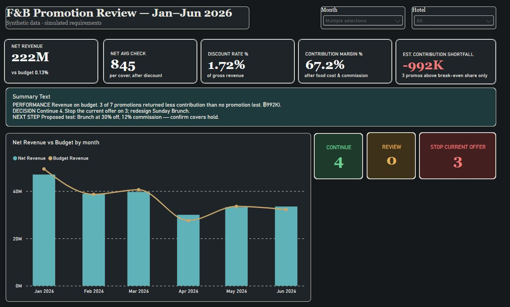
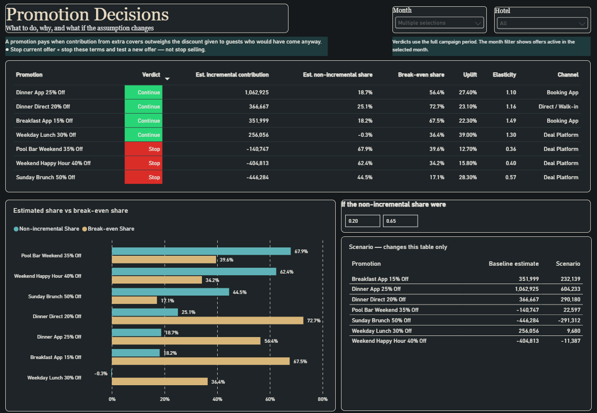
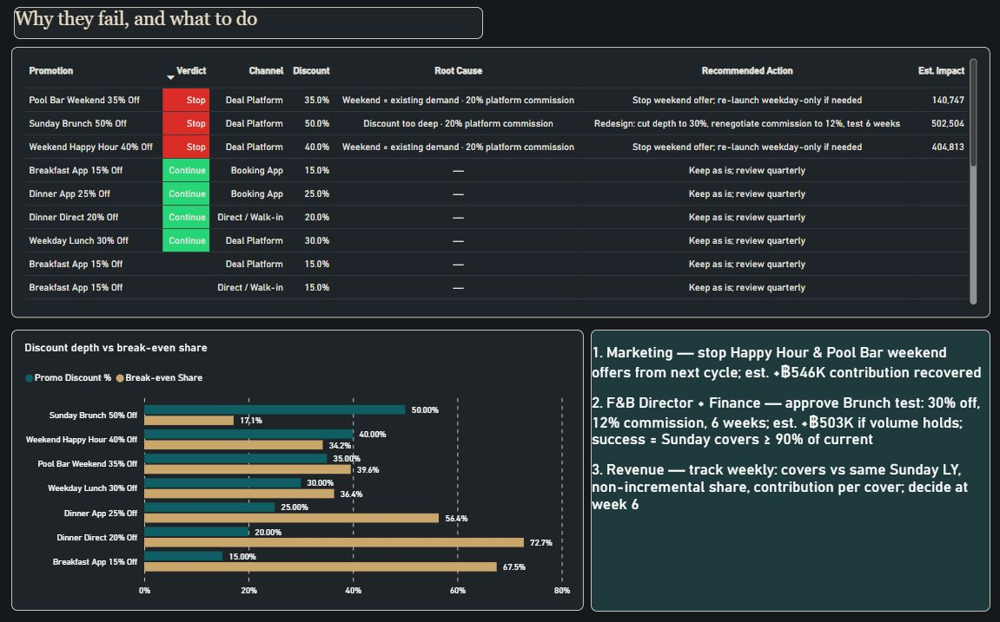
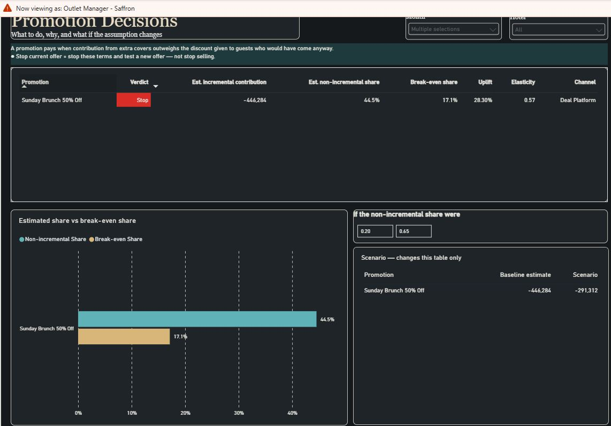

# Which promotions should we stop before high season?
### A Power BI decision project — hotel F&B promotions, judged on contribution, not revenue



**Role this was built for:** Data Analyst – Power BI (business-facing, with RLS and performance responsibilities).
**Everything here is synthetic.** Hotel data is generated; stakeholder requests are simulated from real patterns in my current job. No employer data.

---

## 1. The request, and the real need

A Director of F&B asks: *"Can you give me a report of how our promotions performed this year?"*

Three questions before opening Power BI:

| Question | Answer |
|---|---|
| What decision will this report change? | Which promotions to keep for Q4, which to drop |
| What does "performed" mean — revenue, covers or profit? | "Revenue… but Finance says some promos lose money" |
| Who else acts on it? | Marketing (runs promos), Finance (approves discounts), outlet managers, the GM |

**Agreed need:** one view that tells leadership, per promotion, whether to **continue, review or stop the current offer** — judged on **contribution after discount, food cost and channel commission** — and that each outlet manager can open and see only their own outlets.

## 2. What the report says (Jan–Jun 2026, synthetic)

- Revenue is on budget (฿222.3M, +0.1%).
- **4 promotions continue; 3 should stop on their current terms.** Estimated contribution shortfall from those 3: **−฿992K** (sum of the three, not the net of all seven).
- The two weekend deal-platform offers (Happy Hour 40%, Pool Bar 35%) reach mostly guests who would have come anyway — 62–68% of promo users against a break-even share of 34–40%.
- **Sunday Brunch 50% Off is a redesign candidate, not a drop:** covers were 28% above the same Sundays last year, but at ฿646 off per head only ฿155 of contribution remains, so it tolerates at most 17% non-incremental guests and the baseline estimate is 45%.
- **Proposed test:** Brunch at 30% off with a 12% platform commission for 6 weeks — est. +฿503K if volume holds. Volume holding is the thing the test must confirm.

## 3. The three pages

| Page | Who | Answers |
|---|---|---|
| **Executive** | GM / Director | Are promotions helping or hurting contribution? Performance → Decision → Next step |
| **Promotion Decisions** | Director / Marketing / Finance | Which to continue, review, stop — why — and does the answer survive a different assumption? (what-if slider) |
| **Diagnosis & Action Plan** | F&B leadership | Root cause per promotion (discount depth / weekend demand / channel commission), recommended action, estimated impact, owners and success metric |




## 4. The decision rule (one version, used in SQL, DAX and on the page)

**Baseline** = covers and full-price contribution on the **same weekday last year** (364 days back, Sunday vs Sunday), same outlet and meal period, with no promotion.

| Term | Formula | Plain English |
|---|---|---|
| Uplift | covers on promo days ÷ baseline − 1 | how many more guests came than the same days last year |
| Est. non-incremental share *s* | (promo covers − incremental covers) ÷ promo covers | share of promo users who would have come anyway (estimated from volume, not guest identity) |
| Est. incremental contribution | contribution with promo − baseline covers × contribution per full-price cover | the decision number; both sides after discount, food cost and commission |
| Break-even share *s\** | contribution per promo cover ÷ contribution per full-price cover | how large *s* can get before the promo stops paying |

**Verdict:** Continue if *s* ≤ 0.85·*s\** · Review if 0.85–1.15·*s\** (or the 95% interval of daily uplift crosses 0%) · Stop current offer if above. "Redesign candidate" when Stop and uplift ≥ 20%.
*Stop current offer* means stop these terms and test a new offer — never stop selling the product.

A what-if parameter replaces the baseline estimate of *s* so Finance and Marketing can test their own belief; it changes the scenario table only, verdicts stay on the baseline estimate.

## 5. How it is built

```
/sql        01_views.sql — 3 views hold all business logic (JOIN, CTE, same-weekday-last-year baseline)
/data       FnB_Dashboard_SampleData_v2.xlsx — synthetic source (9 tables) + CSV exports
/pbix       FnB_Promo_Decision.pbix
/docs       screenshots, RLS tests, validation log, KPI dictionary
```

- **SQL:** SQLite (company laptop, no rights for SQL Server — chose a tool that needs no admin). Transformations stay in SQL; Power Query only types columns.
- **Model:** star schema — FactSales (date × hotel × outlet × meal × channel × promo) + FactBudget + 6 dimensions, 12 single-direction many-to-one relationships, auto-detect off.
- **DAX:** measure table with display folders (Base / KPI / Promo decision); verdict, break-even share, incremental contribution, what-if parameter, dynamic summary text.
- **Row-Level Security:** Outlet Manager (one outlet), Hotel GM (one hotel), Group. Tested with *View as* — screenshots in `/docs/rls`.
- **Reconciliation:** CSV → SQLite → Power BI, 16,778 rows / 499,580 covers / ฿423,268,890 net revenue, exact at every layer.



## 6. What went wrong and was fixed (validation log)

| # | Found | Fix |
|---|---|---|
| 1 | Baseline = average of all non-promo days → every promotion flagged Stop (seasonality) | Same weekday last year |
| 2 | Break-even formula assumed every guest got the discount | With-promo vs without-promo contribution |
| 3 | Power Query hard-coded column count; new view columns silently dropped | Columns=29, added to refresh checklist |
| 4 | Verdicts did not respond to the month filter (decision view has no date grain) | Verdict blanks when the filtered period has no promo covers; documented that verdicts are evaluated over the full campaign window |
| 5 | RLS filter placed on DimPromo removed all full-price rows | Filter on DimOutlet only; related the decision view to DimOutlet |
| 6 | First impact estimate for the Brunch redesign double-counted (฿975K) | Recomputed from actual food cost per cover → ฿503K |

## 7. Limitations

Same-weekday-last-year is a comparison, not a control group — the uplift cannot be fully attributed to the promotion. Internal data is synthetic. No guest-level data, so the non-incremental share is inferred from volume. Campaign marketing spend and platform listing fees are not in *s\**, so it is an upper bound. Competitor prices are not yet included.

## 8. Why a hotel project for a non-hotel role

I built this in the business I understand well enough to challenge a request. The method — clarify the decision, define a KPI the business trusts, estimate cannibalisation instead of arguing about it, secure data by role — is the same for a bank's card campaign, fee waiver or deposit-rate promotion: discount ↔ bonus rate, deal-platform commission ↔ channel acquisition cost, outlet-manager RLS ↔ branch RLS.

---
*Thanyachat Theeranithithanatham · Bangkok · [LinkedIn](#) · built Oct–Nov 2026*
